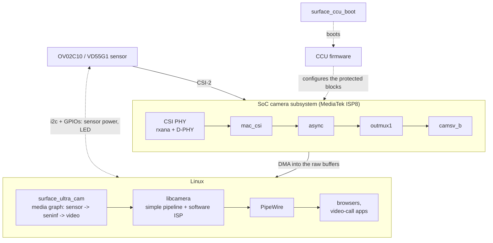

# Using the Surface Laptop Ultra cameras on Linux

A set of drivers that makes the front camera and the IR camera of the
Microsoft Surface Laptop Ultra (NVIDIA N1X SoC, arm64) usable on Linux. Both
become libcamera cameras and show up through PipeWire as
**"Surface Front Camera"** and **"Surface IR Camera"**. Browsers and video-call
apps can use them through PipeWire as is.

This is an unofficial driver built through reverse engineering. It is not
affiliated with Microsoft, NVIDIA or MediaTek.

**Use it at your own risk.** It comes with no warranty. The driver programs the
camera hardware directly through its registers, so a bug can hang the system.

(Japanese: [README_jp.md](README_jp.md))

## Status

| Feature | Status |
|---|---|
| Front camera (OmniVision OV02C10) | **Works**: 1920x1080 colour at 30 fps (the sensor's full 1928-column raw Bayer, turned into colour by libcamera's software ISP), about a third of one CPU core |
| Auto exposure / white balance | **Works** (libcamera's software ISP) |
| IR camera (ST VD55G1) | **Works**: 592x600 grey, 30 fps, lit by the IR LED. Not at the same time as the front camera. Face authentication (as Windows Hello does) is out of scope |
| Privacy LED | On only while a camera is running |
| Suspend / resume | Works |

Tested on kernel 7.3, libcamera 0.7.2 and PipeWire 1.6 (Omarchy, arm64).

## Overview



- `kernel/surface_ccu_boot.c`: powers up the camera side of the SoC and boots
  the CCU (Camera Control Unit) firmware through the SoC's Root of Trust.
- `kernel/sucam_*.c` (`surface_ultra_cam.ko`): a V4L2 driver that exposes a
  media graph per camera (sensor subdev -> seninf subdev -> video node). The
  front camera gives 10-bit Bayer unpacked into 16 bits (`GB10`), the IR camera
  8-bit grey (`GREY`). The sensors are powered only while streaming.
- `libcamera/`: the libcamera configuration (turns the software ISP on) and the
  OV02C10 tuning file.
- `wireplumber/`: the camera names in PipeWire.

See [docs/how-it-works.md](docs/how-it-works.md) for the details, and
[docs/quirks.md](docs/quirks.md) for the hardware quirks and how they are
worked around.

## Requirements

- headers for the running kernel, and `dkms`
- `libcamera` (0.7 or later) and `pipewire-libcamera`
- the CCU firmware `nvCCU.img`. **Extract it from the Windows install on your
  own machine** (it belongs to NVIDIA, so it is not included here). See
  [firmware/README.md](firmware/README.md) for the steps.

## Install

```sh
# 1. firmware (from this machine's Windows partition)
sudo ./firmware/extract-from-windows.sh
sudo install -Dm644 firmware/nvCCU.img /lib/firmware/nvidia/n1x/nvCCU.img

# 2. install everything
sudo ./packaging/install.sh
```

`install.sh` does the following:

- registers the kernel modules with DKMS (they are rebuilt automatically on
  kernel updates)
- installs `/etc/modprobe.d/surface-ultra-camera.conf` and
  `/etc/modules-load.d/surface-ultra-camera.conf`
- installs the libcamera configuration `/usr/share/libcamera/configuration.yaml`
  and the tuning file `/usr/share/libcamera/ipa/simple/ov02c10.yaml`
- installs the WirePlumber configuration (camera names) and a session
  environment variable (runs the software ISP on the CPU)
- removes `sucamd` and the v4l2loopback setup of 0.1 if they are still there

It is safe to run again after pulling updates. `sudo ./packaging/uninstall.sh`
removes everything.

After installing, log out and back in once (so that PipeWire starts with the
new environment). Then pick **"Surface Front Camera"** in your camera app.

### Browsers

- Chromium needs to be told to use PipeWire cameras: add
  `--enable-features=WebRtcPipeWireCamera` to its options (on Omarchy,
  `~/.config/chromium-flags.conf`).
- Firefox uses PipeWire cameras by default.

### Apps without PipeWire support

Start them with `pw-v4l2` (package `pipewire-v4l2`) or `libcamerify` (comes
with `libcamera`) in front. Either way the app sees an ordinary V4L2 device.

```sh
pw-v4l2 app         # through PipeWire; works alongside the browser. Not for the IR camera (grey)
libcamerify app     # libcamera directly; works for the IR camera too
```

### About the IR camera

- Room lighting contains almost no IR, so only what the IR LED lights shows up.
- The exposure is fixed by default (2000 lines, 2x gain). The IR LED's driver
  cuts long pulses (the LED goes off with exposures longer than about 2800
  lines), so the sensor's own auto exposure is not used. The exposure is capped
  at 2500 lines.
- Apps that do not accept grey formats (Chromium, for one) do not list it. Use
  `cam`, GStreamer (`libcamerasrc`), `libcamerify` and the like. Saving a PNG:

  ```sh
  gst-launch-1.0 -q libcamerasrc camera-name="platform/surface-ultra-cam.1 vd55g1" \
    ! video/x-raw,format=GRAY8,width=592,height=600 ! fdsink \
    | ffmpeg -loglevel error -f rawvideo -pix_fmt gray -video_size 592x600 -i - \
      -vf "select=eq(n\,30)" -frames:v 1 -update 1 ir.png
  ```

- The front and IR cameras share the path to camsv (outmux1 -> camsv_b), so
  they cannot run at the same time. Whichever is opened second gets `EBUSY`.
- The sensor subdev ("vd55g1 18-0010") has V4L2 controls: `exposure`,
  `analogue_gain`, `auto_exposure` (manual by default), `auto_exposure_bias`
  and `led_mode` (IR LED, `0` turns it off).

## Troubleshooting

```sh
journalctl -k -b | grep -iE 'surface-ccu-boot|surface-ultra-cam'
cam -l
wpctl status
```

- `CCU firmware not running`: `surface_ccu_boot` could not boot the CCU.
  Check that the firmware is in place, and look at the `surface_ccu_boot` log.
- No camera in `cam -l`: check that `/usr/share/libcamera/configuration.yaml`
  exists, and that `media-ctl -p -d /dev/media0` shows the driver name
  `mtk-seninf`.
- No picture, or a black one: check that PipeWire's environment has
  `LIBCAMERA_SOFTISP_MODE=cpu` (`systemctl --user show-environment`). The GPU
  version of the software ISP does not work on NVIDIA's EGL.

## Known limitations

- The driver calls itself `mtk-seninf`. libcamera's simple pipeline picks
  devices by driver name, and this driver's name is not registered yet. It
  really does drive MediaTek's seninf, so it borrows that name.
- The colour correction in the tuning file is not measured from a colour chart.
  It is a plain 1.6x saturation boost, chosen by eye.
- libcamera's simple pipeline reports no frame-rate range, so the PipeWire
  cameras carry no frame-rate information either. GStreamer's `pipewiresrc`
  does not connect unless the format
  (`video/x-raw,format=...,width=...,height=...`) is given.

## Porting / re-capturing the register tables

The register tables in `kernel/` were observed on a running Windows system with
`tools/windows-ccusnoop/` (a small, read-only Windows kernel driver). Machines
with the same SoC but a different sensor will need a new capture.

## License

GPL-2.0, see [LICENSE](LICENSE). The OV02C10 mode table comes from the
mainline Linux `ov02c10` driver. The libcamera and WirePlumber configuration
files are CC0-1.0.
