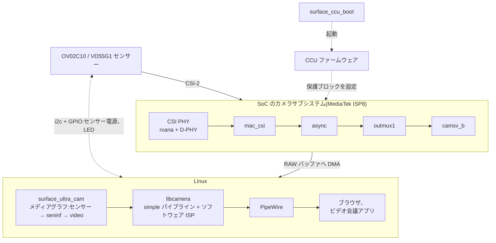

# Surface Laptop Ultra のカメラを Linux で使う

Microsoft Surface Laptop Ultra(NVIDIA N1X SoC、arm64)のフロントカメラと
IR カメラを Linux で使えるようにするドライバ一式です。どちらも libcamera の
カメラになり、PipeWire を通して **"Surface Front Camera"** と
**"Surface IR Camera"** として見えます。ブラウザやビデオ会議アプリは
PipeWire からそのまま使えます。

リバースエンジニアリングで作った非公式のドライバです。Microsoft・NVIDIA・
MediaTek とは関係ありません。

**自己責任で使ってください。** 何の保証もありません。カメラのハードウェアを
レジスタで直接操作するドライバなので、不具合があるとシステムが固まる
ことがあります。

(英語版: [README.md](README.md))

## 対応状況

| 機能 | 状態 |
|---|---|
| フロントカメラ(OmniVision OV02C10) | **動作**:1920x1080 のカラー、30 fps(センサーの横 1928 画素ぶんの RAW Bayer を libcamera のソフトウェア ISP がカラー画像にする)。CPU 使用量は 1 コアの約 1/3 |
| 自動露出 / ホワイトバランス | **動作**(libcamera のソフトウェア ISP) |
| IR カメラ(ST VD55G1) | **動作**:592x600 の白黒、30 fps、IR LED で照らす。フロントカメラと同時には使えない。顔認証(Windows Hello 相当)は対象外 |
| プライバシー LED | カメラが動いている間だけ点灯 |
| サスペンド / 復帰 | 動作 |

カーネル 7.3、libcamera 0.7.2、PipeWire 1.6(Omarchy、arm64)で確認しています。

## 全体の構成



- `kernel/surface_ccu_boot.c`:カメラ周りの電源を入れ、SoC の Root of Trust
  経由で CCU(Camera Control Unit)のファームウェアを起動します。
- `kernel/sucam_*.c`(`surface_ultra_cam.ko`):カメラごとにメディアグラフ
  (センサーの subdev → seninf の subdev → video ノード)を出す V4L2 ドライバ。
  フロントカメラは 16 ビットに展開した 10 ビット Bayer(`GB10`)、IR カメラは
  8 ビットの白黒(`GREY`)を出します。センサーへの給電はストリーム中だけです。
- `libcamera/`:libcamera の設定(ソフトウェア ISP を有効にする)と、OV02C10 の
  調整ファイル。
- `wireplumber/`:PipeWire でのカメラの名前。

詳細は [docs/how-it-works_jp.md](docs/how-it-works_jp.md)、ハードウェアの癖と
その回避策は [docs/quirks_jp.md](docs/quirks_jp.md) を参照してください。

## 必要なもの

- 動作中カーネルのヘッダと `dkms`
- `libcamera`(0.7 以降)と `pipewire-libcamera`
- CCU ファームウェア `nvCCU.img`。**自分のマシンの Windows から抜き出して
  ください**(NVIDIA のものなので、ここには含めていません)。手順は
  [firmware/README_jp.md](firmware/README_jp.md)

## インストール

```sh
# 1. ファームウェア(このマシンの Windows パーティションから)
sudo ./firmware/extract-from-windows.sh
sudo install -Dm644 firmware/nvCCU.img /lib/firmware/nvidia/n1x/nvCCU.img

# 2. 全部インストール
sudo ./packaging/install.sh
```

`install.sh` は次のことをします。

- カーネルモジュールを DKMS に登録する(カーネル更新時に自動で再ビルドされる)
- `/etc/modprobe.d/surface-ultra-camera.conf` と
  `/etc/modules-load.d/surface-ultra-camera.conf` を置く
- libcamera の設定 `/usr/share/libcamera/configuration.yaml` と、調整ファイル
  `/usr/share/libcamera/ipa/simple/ov02c10.yaml` を置く
- WirePlumber の設定(カメラの名前)と、セッションの環境変数(ソフトウェア ISP を
  CPU で動かす)を置く
- 0.1 の `sucamd` と v4l2loopback の設定が残っていれば取り除く

更新を取り込んだあとに再実行しても大丈夫です。`sudo ./packaging/uninstall.sh` で
全部取り除けます。

インストールのあと、一度ログインし直してください(PipeWire が新しい環境変数で
起動します)。カメラアプリで **"Surface Front Camera"** を選べば映ります。

### ブラウザ

- Chromium は PipeWire のカメラを使う設定が要ります。`--enable-features=WebRtcPipeWireCamera`
  を起動オプションに足してください(Omarchy では `~/.config/chromium-flags.conf`)。
- Firefox は既定で PipeWire のカメラを使います。

### PipeWire に対応していないアプリ

`pw-v4l2`(`pipewire-v4l2` パッケージ)か `libcamerify`(`libcamera` に同梱)を
前に付けて起動します。どちらもアプリから普通の V4L2 デバイスに見えます。

```sh
pw-v4l2 アプリ名       # PipeWire 経由。ブラウザと同時に使える。IR カメラ(白黒)は未対応
libcamerify アプリ名   # libcamera を直接使う。IR カメラも使える
```

### IR カメラについて

- 室内の照明にはほとんど IR が含まれないので、IR LED で照らした範囲だけが写ります。
- 露出は既定で固定(2000 ライン、ゲイン 2 倍)です。IR LED の駆動回路は長い
  パルスを打ち切るので(約 2800 ラインより長い露出で LED が消える)、センサー
  内蔵の自動露出は使っていません。露出の上限は 2500 ラインです。
- 白黒の形式を受け付けないアプリ(Chromium など)には表示されません。`cam`、
  GStreamer(`libcamerasrc`)、`libcamerify` などで使えます。PNG に保存する例:

  ```sh
  gst-launch-1.0 -q libcamerasrc camera-name="platform/surface-ultra-cam.1 vd55g1" \
    ! video/x-raw,format=GRAY8,width=592,height=600 ! fdsink \
    | ffmpeg -loglevel error -f rawvideo -pix_fmt gray -video_size 592x600 -i - \
      -vf "select=eq(n\,30)" -frames:v 1 -update 1 ir.png
  ```

- フロントカメラと IR カメラは camsv までの経路(outmux1 → camsv_b)を共有して
  いるので、同時には使えません。後から開いた方は `EBUSY` になります。
- センサーの subdev("vd55g1 18-0010")に V4L2 コントロールがあります:
  `exposure`、`analogue_gain`、`auto_exposure`(既定は手動)、
  `auto_exposure_bias`、`led_mode`(IR LED、`0` で消灯)。

## うまく動かないとき

```sh
journalctl -k -b | grep -iE 'surface-ccu-boot|surface-ultra-cam'
cam -l
wpctl status
```

- `CCU firmware not running`:`surface_ccu_boot` が CCU を起動できていません。
  ファームウェアが置かれているかと、`surface_ccu_boot` のログを確認してください。
- `cam -l` にカメラが出ない:`/usr/share/libcamera/configuration.yaml` があるか、
  `media-ctl -p -d /dev/media0` のドライバ名が `mtk-seninf` になっているかを確認して
  ください。
- 映像が出ない、または真っ黒:PipeWire の環境に `LIBCAMERA_SOFTISP_MODE=cpu` が
  入っているか(`systemctl --user show-environment`)を確認してください。ソフトウェア
  ISP の GPU 版は NVIDIA の EGL で動きません。

## 既知の制限

- ドライバ名を `mtk-seninf` と名乗っています。libcamera の simple パイプラインは
  ドライバ名で対象を選び、このドライバの名前がまだ登録されていないためです。
  実際に MediaTek の seninf を動かしているので、その名前を借りています。
- 調整ファイルの色補正は、色見本で測ったものではありません。目で見て選んだ、
  彩度を 1.6 倍にするだけの行列です。
- libcamera の simple パイプラインはフレームレートの範囲を出さないので、
  PipeWire のカメラにもフレームレートの情報がありません。GStreamer の
  `pipewiresrc` は、形式(`video/x-raw,format=...,width=...,height=...`)を
  指定しないとつながりません。

## 移植 / レジスタ表の取り直し

`kernel/` のレジスタ表は、Windows の動作中に `tools/windows-ccusnoop/`
(読み取り専用の小さな Windows カーネルドライバ)で観測したものです。同じ SoC
でもセンサーが違う機種では、取り直しが必要になります。

## ライセンス

GPL-2.0。[LICENSE](LICENSE) を参照してください。OV02C10 のモード表は
mainline Linux の `ov02c10` ドライバ由来です。libcamera と WirePlumber の設定
ファイルは CC0-1.0 です。
