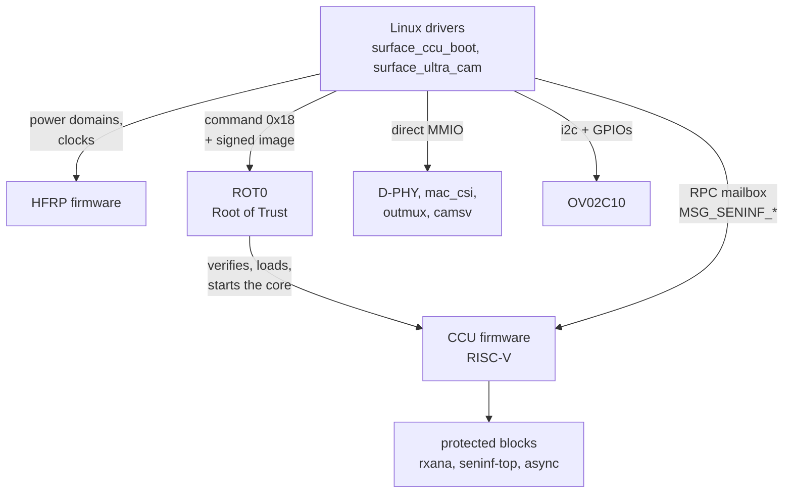

# How it works

(Japanese: [how-it-works_jp.md](how-it-works_jp.md))

The Surface Laptop Ultra's front camera is an OmniVision OV02C10, connected to
the SoC's camera subsystem over a 2-lane MIPI CSI-2 D-PHY link. The camera
subsystem is a MediaTek ISP8 (mt8991-family) design combined with NVIDIA
firmware. Some of its blocks are access-protected and can only be configured by
the CCU firmware, so the driver asks the firmware to do those parts and writes
the rest directly.

Who configures what:



## Blocks and addresses

| Block | Address | Access |
|---|---|---|
| HFRP power/clock mailbox | `0x31160000` | CPU |
| ROT0 (Root of Trust) mailbox, ACPI `NVDA8600` | `0x18010000` | CPU |
| CCU control window / RPC mailbox | `0x3C080000` | CPU |
| rxana A/B (CSI analogue receiver, port 0) | `0x12A10000`, `0x12A11000` | CCU |
| D-PHY, mac_top, mac_csi (port 0) | `0x12A12000`, `0x12A14000`, `0x12A15000` | CPU |
| seninf-top, async, TG | `0x3A300000`, `0x3A301000`, `0x3A302000` | CCU |
| outmux 0..13 | `0x3A100000 + n * 0x10000` | CPU |
| camsv_b (central part; the DMA block is at +0x1000) | `0x3A510000` | CPU |
| CAM main | `0x3A000000` | CPU |

Blocks whose access is "CCU" are firewalled from the CPU: reads return 0 and
writes are dropped.

## Power and clocks

Power domains and clocks are requested from the HFRP firmware with a 256-byte
mailbox message (doorbell `+0x100`, reply status `+0x104`, clear `+0x10c`).

- Type 1: power domain `{domain (u32), on}`. The camera needs domains 0 and 2
  (seninf) and 5 (CCU).
- Type 2: clock gates `{ids[20] (u32), [81] = on, [82] = count}`. Seninf uses
  `0xa04 0xa09 0xa0a`, the CCU `0x1a00-0x1a02 0x1a04 0x652`, CSI PHY0 `0x813`,
  and camsv `0xa04 0xa01 0xa0b 0xa10-0xa13 0xa17` plus `0xa00 0xa18` for
  camsv_b.
- Type 3: clock rate `{id, MHz}`. PHY0 is id 6 at 312 MHz.

The sensor power, reset, MCLK gate and privacy LED are five GPIOs, listed in
the `_CRS` of the ACPI node `\_SB.CAMF` (`OVTI02C1`) in the order campower,
avdd, reset (active low), mclk, pled. They are named with
`acpi_dev_add_driver_gpios()`, and `surface_ultra_cam` drives them only while
streaming.

## Booting the CCU (surface_ccu_boot)

The CCU is a RISC-V core that runs NVIDIA's signed firmware (`nvCCU.img`).
`nvCCU.img` is a container holding one image per SoC variant; this machine uses
the `mt8991` one. `surface_ccu_boot` binds to ROT0 and does the following, in
order:

1. Powers up the CCU (domains 0/2/5 and the clocks above) and initialises its
   control registers.
2. Strips the 4-byte type tag `0x000C0300` from the image and copies it into a
   physically contiguous buffer **low in DRAM** (see [quirks](quirks.md)).
3. Sends ROT0 the command `0x18 {type, size, physical address}`. ROT0 verifies
   the signature, loads the image and starts the core.
4. Waits for the CCU handshake register (`0x3C0B0020`) to reach `0xffff00a5`.

## Talking to the CCU

RPCs use a shared header at `0x3C0BC0C8` (`{w_idx, r_idx, feature, cmd, token,
len, status}`), the payload at `0x3C0BC0E4` and a doorbell at `0x3C0B00A0`.
The status reads `0x66669999` while a command is being processed and returns
the command id unchanged on success. Feature 4 is seninf (`MSG_SENINF_*`).
The commands used are:

- `0x00` set_iomem: tells the firmware where seninf-top, async and the outmuxes are
- `0x82 0x85 0x86 0x87`: seninf-top common registers; `0x80 0x89`: async
- `0xa0`: secure write to rxana (allowed ranges only); `0xa1-0xa4`: PHY setup
- `0x84 / 0x83`: outmux clock gates
- `0x01` SET_SENSOR `{sensor id, type, 0, CSI port, sel_mipi, 0}`
- `0x02` SET_STREAM `{sensor id, on}`

The exact order sent for one stream start is replayed from a capture taken on
Windows (`kernel/ccu_replay.h`).

## Stream-start sequence (surface_ultra_cam)

1. Turn on the power domains and clocks through HFRP (always first; see the
   quirks).
2. Power the sensor through the GPIOs and check its chip id (`0x300A` =
   `56 02 43`).
3. Set the outmux state (all non-waived outmuxes), then send the CCU commands
   up to SET_SENSOR: iomem, common registers, rxana/PHY, async.
4. D-PHY and mac_csi: reset the mac, write the Windows register values, and set
   CSI2_EN last.
5. Set the outmux state again, and set `SW_CFG_DONE` on each outmux to make it
   take effect.
6. camsv_b: write the Windows register values and set the per-frame DMA
   registers for TAG2/IMG2 (address, stride 2400, burst). Then enable the FBC
   with one buffer's worth of credit, set the LARB13 virtual channel, load the
   double buffer, and set `CMOS_EN` / `VFDATA_EN`.
7. Sensor: write the mode table, the frame length and the exposure/gains, and
   start streaming.
8. 40 ms later, send the remaining CCU commands: SET_SENSOR, the outmux clock
   gates and SET_STREAM. Inside SET_SENSOR the firmware picks every outmux
   whose `SRC_SEL` (`+0x18`) sensor select is below 2, assigns it to the
   sensor's CSI port, and locks the seninf-top mux and async routing.
9. Check that data reaches outmux1 (whether its debug port `+0x28` moves). If it
   does not, restart once.

The data path is OV02C10 → D-PHY → mac_csi → async → outmux1 (tag 1) →
camsv_b (TAG2, written by WDMA IMG2).

## Frame delivery

The driver runs from camsv_b's SOF interrupt (GSI `0x20D` in ISP1's `_CRS`,
enabled with `SOF_STATUS_EN 0x35C` = `0x40` as on Windows). The interrupt is
only registered while streaming, because at other times the camsv is unpowered
and reading it stalls the bus. If the interrupt is unavailable, or with the
module parameter `poll=1`, a kernel thread polls every 1 ms instead. Each
interrupt does the following, in order:

- **Done**: if the FBC write count (bits 15:8 of `FBC1_TAG2 0x584`) has moved,
  the "writing" buffer is returned to user space. A frame finishes being
  written before the next SOF, so checking at SOF is enough.
- **SOF** (bit 6 of `SOF_STATUS 0x360` is TAG2; it clears on read): the outer
  WDMA address register has just been latched for the new frame. The buffer
  that was "pending" moves to "writing", and the next queued buffer is set up
  right away (its address plus one FBC credit with `RCNT_INC`). This gives a
  whole frame time to set up the next buffer.

When no buffer is queued the FBC has no credit, so the hardware drops the frame
instead of overwriting a buffer the application is holding.

## Raw format

1928x1080 (camsv takes the full width and the top 1080 lines of the sensor's
1928x1092), 10-bit Bayer **GBRG**, written unpacked into 16 bits per pixel
(little-endian, upper 6 bits zero). That is V4L2 `SGBRG10` (fourcc `GB10`),
3856 bytes per line, black level 64. A frame is 4164480 bytes, just under the
largest contiguous DMA buffer this machine can allocate (4 MiB, no CMA).

The full width is what makes 1080p possible: the software ISP gives up 2
columns on each side to demosaic. Windows grabs 1920 columns (as 0.2 did),
which left libcamera at 1916x1080 at most, and PipeWire then offered nothing
above 1680x1050. From 1928 columns it outputs up to 1924x1080, so 1920x1080 is
offered. The outmux tag sizes and the camsv grab are widened over the Windows
register values for this (`front_omux` / `front_camsv` in `sucam_hw.c`).

Windows uses 10 bits packed the MediaTek way (2400 bytes per line), which
libcamera's software ISP cannot read. A sweep found that bit 6 of camsv's
`FORMAT_TAG2` (+0x594) gives the unpacked form
([camsv-output-format.md](camsv-output-format.md)). No setting for CSI-2
packing (`SGBRG10P`) has been found.

## Media graph

So that libcamera's simple pipeline can handle them, each camera gets a media
graph:

```
"ov02c10 14-0036" (sensor subdev) -> "surface-ultra-seninf" (subdev) -> video node
"vd55g1 18-0010"  (sensor subdev) -> "surface-ultra-seninf" (subdev) -> video node
```

The sensors and seninf are actually programmed by this driver (`sucam_hw.c`),
so the subdevs only describe each camera's one fixed mode and carry the sensor
controls. The stream starts at the video node's STREAMON.

Controls on the front camera's sensor subdev: `exposure` (lines, 4..1454),
`analogue_gain` (0x10..0xf8, gain x16), `digital_gain` (0x400..0x3fff, gain
x1024), `vertical_blanking`, plus `horizontal_blanking` / `pixel_rate`
(read-only, for libcamera's frame-time calculation) and `camera_orientation`.
The sensor is programmed in lines only, so `pixel_rate` is chosen, with a
2280-pixel line, to match the measured 30 fps (VTS 1462).

## libcamera

- **Pipeline.** The simple pipeline picks devices by the media device's driver
  name. This driver's name is not registered yet, so the module parameter
  `mdev_name=mtk-seninf` makes it pose as MediaTek's seninf (which is what it
  drives). libcamera lists `mtk-seninf` without the software ISP, so
  `libcamera/configuration.yaml` turns it on.
- **Software ISP.** It demosaics, white-balances, auto-exposes and
  colour-corrects the front camera's raw Bayer into an image, in about a third
  of a CPU core at 1080p30. The GPU version does not work on the NVIDIA
  driver's EGL (`glFramebufferTexture2D` fails with 0x8CD6, no frames), so
  `LIBCAMERA_SOFTISP_MODE=cpu` selects the CPU one.
- **Tuning file.** `libcamera/ipa/simple/ov02c10.yaml`: black level 64 (4096 on
  libcamera's 16-bit scale) and a colour matrix that boosts saturation 1.6x
  (chosen by eye, not measured from a chart).
- **IR camera.** The software ISP has no mono path, so the driver writes 8-bit
  grey (`GREY`) and libcamera passes it through.
- **PipeWire.** libcamera reports both cameras as front-facing, so WirePlumber
  names both "Built-in Front Camera". The configuration in `wireplumber/`
  renames them "Surface Front Camera" and "Surface IR Camera".

The stream runs, and the sensor is powered, only while some application uses
the camera (the privacy LED is lit only then too).

## IR camera

An ST VD55G1 (monochrome, global shutter, one lane) sits at ACPI `\_SB.CAMI` (`SMO55F1`), on
I2C 0x10, with GPIOs campower 35 / avdd 104 / reset 101 (active-low). There is no MCLK GPIO:
the sensor runs from its own 12 MHz oscillator.

**Sensor.** After power-up it reaches READY_TO_BOOT; writing `EXT_CLOCK` (0x0220) = 12 MHz,
the firmware patch 2.9 (the one in the mainline `vd55g1` driver) at 0x2000 and `BOOT = 2`
brings it to SW_STBY. The mode is exactly the 112 register writes of the Windows sensor driver
(`surfacemipicamsensor.sys`): 1086 Mbps, the centre 600x600 of 804x704, RAW10, and the IR LED
strobed from sensor GPIO2. Windows alternates two contexts for face authentication; here a
single context with twice the frame length (30 fps) is used.
With settings of our own (600 Mbps and so on) SYSTEM_FSM dropped to 0xFF right after streaming
started.

**Receive path.** CSI port 2 (PHY2 0x12A20000) -> mac_csi2 -> async 2 -> outmux1 -> camsv_b.
The CCU command sequence and the PHY/mac values come from the front camera's capture with the
port number, rxana addresses and lane count replaced (`kernel/ir_tables.h`). The key is
**`MIPI_SPLIT = 1`** in the async (set_async `0x89 {2, 1, 0, 1}`): PHY2 is a 4D1C port and a
one-lane sensor counts as its A half. With 0, mac_csi2 put out 600x600 (`SIZE_CHK` RCV0 +0x448
= 0x02580258) but nothing entered async 2, and the outmux's `SW_CFG_DONE` (+0x1c) stayed 1
(the configuration never latched). outmux0 -> camsv_a did not work, so the IR camera uses the
front camera's outmux1 -> camsv_b and the two cannot run together.

**Output.** camsv writes the centre 592 of the 600 columns (4 dropped on each side) as 8-bit
grey. Lines are then 16-byte aligned and need no padding (with padding, ffmpeg's V4L2 input
drops every frame as the wrong size).

**Exposure and the IR LED.** Only what the IR LED lights shows up (room lighting has almost no
IR; with the LED off the picture stays at the black level at any exposure). The sensor strobes
the LED for the exposure time, but the LED driver cuts long pulses. At gain 0, the brightness
above black was +4 at 124 lines, +20 at 500, +39 at 1000 and +77 at 2000; the LED was still lit
at about 2800, and from 3000-3300 on the picture was black. The sensor's own auto exposure
runs the exposure up to nearly the frame length (about 3950 lines), which gives the LED off
and only the gain up: a dark, noisy picture. So the default is manual exposure at 2000 lines,
2x analogue gain, with the exposure capped at 2500 lines. The privacy LED (pin 43, which ACPI
also lists in CAMI's `_CRS`) is lit while the IR camera runs too.

**Useful for debugging.**

- mac_csi `+0xd4` (last long packet: WC/VC/DT; 0x02ee002b for the IR camera), `+0xdc` (packet
  counts), `+0x440/+0x448` (SIZE_CHK: write 0x002b0011 to CTRL0, read the received size in RCV0).
- outmux `+0x1c` back at 0 means the configuration latched; `+0xac` is the measured tag size.
- CCU `0x8a` (SET_TEST_MODEL, 26 words `{async, 0, lines, pixels, 0, 1, vc[10], dt[10]}`) runs
  an async test pattern, which tests async -> outmux -> camsv without the sensor, PHY or mac.
