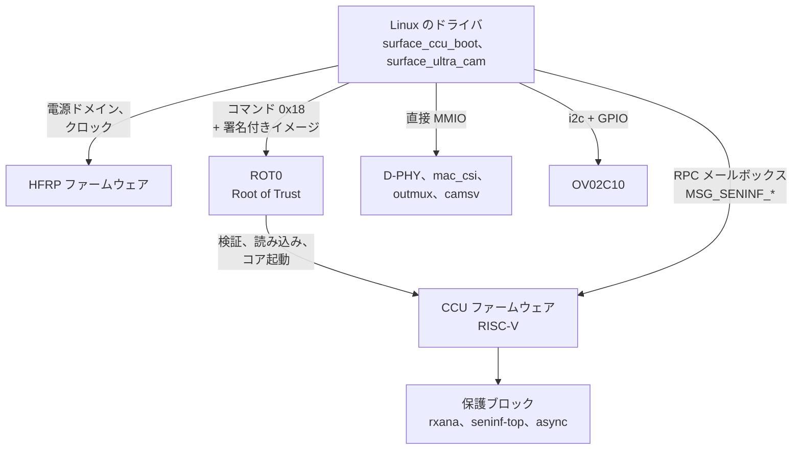

# 仕組み

(英語版: [how-it-works.md](how-it-works.md))

Surface Laptop Ultra のフロントカメラは OmniVision OV02C10 で、2 レーンの
MIPI CSI-2 D-PHY で SoC のカメラサブシステムにつながっています。カメラ
サブシステムは MediaTek ISP8(mt8991 系)の設計に NVIDIA のファームウェアを
組み合わせたものです。一部のブロックはアクセス保護されていて CCU
ファームウェアからしか設定できないため、ドライバはその部分をファームウェアに
依頼し、残りは直接書き込みます。

誰が何を設定するか:



## ブロックとアドレス

| ブロック | アドレス | アクセス |
|---|---|---|
| HFRP 電源/クロック メールボックス | `0x31160000` | CPU |
| ROT0(Root of Trust)メールボックス、ACPI `NVDA8600` | `0x18010000` | CPU |
| CCU 制御ウィンドウ / RPC メールボックス | `0x3C080000` | CPU |
| rxana A/B(CSI のアナログ受信部、ポート 0) | `0x12A10000`, `0x12A11000` | CCU |
| D-PHY、mac_top、mac_csi(ポート 0) | `0x12A12000`, `0x12A14000`, `0x12A15000` | CPU |
| seninf-top、async、TG | `0x3A300000`, `0x3A301000`, `0x3A302000` | CCU |
| outmux 0..13 | `0x3A100000 + n * 0x10000` | CPU |
| camsv_b(中央部。DMA ブロックは +0x1000) | `0x3A510000` | CPU |
| CAM main | `0x3A000000` | CPU |

アクセスが「CCU」のブロックは CPU からはファイアウォールで遮断されていて、
読むと 0、書き込みは捨てられます。

## 電源とクロック

電源ドメインとクロックは、HFRP ファームウェアに 256 バイトのメールボックス
メッセージで依頼します(ドアベル `+0x100`、応答ステータス `+0x104`、
クリア `+0x10c`)。

- タイプ 1:電源ドメイン `{domain (u32), on}`。カメラにはドメイン 0 と 2
  (seninf)、5(CCU)が必要。
- タイプ 2:クロックゲート `{ids[20] (u32), [81] = on, [82] = 個数}`。
  seninf は `0xa04 0xa09 0xa0a`、CCU は `0x1a00-0x1a02 0x1a04 0x652`、
  CSI PHY0 は `0x813`、camsv は `0xa04 0xa01 0xa0b 0xa10-0xa13 0xa17` に加えて、
  camsv_b 用の `0xa00 0xa18`。
- タイプ 3:クロック周波数 `{id, MHz}`。PHY0 は id 6 で 312 MHz。

センサーの電源・リセット・MCLK のゲート・プライバシー LED は 5 本の GPIO で、
ACPI ノード `\_SB.CAMF`(`OVTI02C1`)の `_CRS` に campower、avdd、reset
(アクティブロー)、mclk、pled の順で並んでいます。`acpi_dev_add_driver_gpios()`
で名前を付け、`surface_ultra_cam` がストリーム中だけ駆動します。

## CCU の起動(surface_ccu_boot)

CCU は RISC-V コアで、NVIDIA の署名付きファームウェア(`nvCCU.img`)で
動きます。`nvCCU.img` は SoC の種類ごとのイメージを入れたコンテナで、
このマシンでは `mt8991` 向けを使います。`surface_ccu_boot` は ROT0 に
バインドして、次の順に処理します。

1. CCU に電源を入れ(ドメイン 0/2/5 と上記のクロック)、制御レジスタを
   初期化する。
2. イメージから 4 バイトの型タグ `0x000C0300` を除き、物理的に連続した
   **DRAM の低い位置**のバッファにコピーする([癖](quirks_jp.md)を参照)。
3. ROT0 にコマンド `0x18 {type, size, 物理アドレス}` を送る。ROT0 が署名を
   検証し、イメージを読み込んでコアを起動する。
4. CCU のハンドシェイクレジスタ(`0x3C0B0020`)が `0xffff00a5` になるのを
   待つ。

## CCU とのやり取り

RPC は `0x3C0BC0C8` の共有ヘッダ(`{w_idx, r_idx, feature, cmd, token, len,
status}`)、`0x3C0BC0E4` のペイロード、`0x3C0B00A0` のドアベルで行います。
ステータスは処理中は `0x66669999` で、成功するとコマンド ID がそのまま
返ります。feature 4 が seninf(`MSG_SENINF_*`)です。使うコマンドは次の
とおりです。

- `0x00` set_iomem:seninf-top、async、outmux の場所をファームウェアに教える
- `0x82 0x85 0x86 0x87`:seninf-top の共通レジスタ、`0x80 0x89`:async
- `0xa0`:rxana へのセキュア書き込み(許可された範囲のみ)、`0xa1-0xa4`:PHY の設定
- `0x84 / 0x83`:outmux のクロックゲート
- `0x01` SET_SENSOR `{センサー ID, 種別, 0, CSI ポート, sel_mipi, 0}`
- `0x02` SET_STREAM `{センサー ID, on}`

1回のストリーム開始で送る正確な順序は、Windows で採取したものを再生して
います(`kernel/ccu_replay.h`)。

## ストリーム開始の手順(surface_ultra_cam)

1. HFRP で電源ドメインとクロックを入れる(必ず最初に。癖を参照)。
2. GPIO でセンサーに給電し、チップ ID を確認する(`0x300A` = `56 02 43`)。
3. outmux の状態を設定(waive されていない全 outmux)し、SET_SENSOR の手前
   までの CCU コマンドを送る:iomem、共通レジスタ、rxana/PHY、async。
4. D-PHY と mac_csi:mac をリセットし、Windows のレジスタ値を書き、
   最後に CSI2_EN を立てる。
5. もう一度 outmux の状態を設定し、各 outmux の `SW_CFG_DONE` を立てて
   反映させる。
6. camsv_b:Windows のレジスタ値を書き、TAG2/IMG2 のフレーム単位の DMA
   レジスタ(アドレス、ストライド 2400、バースト)を設定する。続けて FBC を
   有効にしてバッファ 1 枚分のクレジットを与え、LARB13 の仮想チャネルを
   設定し、二重バッファを読み込ませてから `CMOS_EN` / `VFDATA_EN` を立てる。
7. センサー:モード表、フレーム長、露出/ゲインを書き、ストリームを開始する。
8. 40 ms 後に残りの CCU コマンドを送る:SET_SENSOR、outmux のクロック
   ゲート、SET_STREAM。SET_SENSOR の中でファームウェアは、`SRC_SEL`
   (`+0x18`)のセンサー選択が 2 未満の outmux をすべて選んでセンサーの
   CSI ポートに割り当て、seninf-top の mux と async の経路を固定する。
9. outmux1 までデータが届いているか確認する(デバッグポート `+0x28` が動く
   かどうか)。届いていなければ一度だけやり直す。

データの経路は、OV02C10 → D-PHY → mac_csi → async → outmux1(tag 1)→
camsv_b(TAG2、WDMA IMG2 で書き込み)です。

## フレームの受け渡し

camsv_b の SOF 割り込み(ISP1 の `_CRS` にある GSI `0x20D`。Windows と同じく
`SOF_STATUS_EN 0x35C` = `0x40` で有効)で動きます。割り込みはストリーム中だけ
登録します。それ以外の時間は camsv の電源が落ちていて、読むとバスが止まるからです。
割り込みが取れないとき、またはモジュールパラメータ `poll=1` のときは、カーネル
スレッドが 1 ms ごとにポーリングします。割り込みごとに、次の順で処理します。

- **完了**:FBC の書き込みカウント(`FBC1_TAG2 0x584` の bit 15:8)が進んで
  いたら、「書き込み中」のバッファをユーザー空間に返す。フレームの書き込みは
  次の SOF より前に終わるので、SOF の時点で確認すれば足りる。
- **SOF**(`SOF_STATUS 0x360` の bit 6 が TAG2。読むとクリアされる):
  外側の WDMA アドレスレジスタが、新しいフレーム用にちょうどラッチされた
  ところ。「予約中」だったバッファを「書き込み中」に移し、次のキューの
  バッファをすぐに設定する(アドレスと、`RCNT_INC` による FBC クレジット
  1 つ)。これで次のバッファの設定に丸々 1 フレーム分の時間がある。

キューにバッファが無いときは FBC にクレジットが無いので、ハードウェアは
アプリが持っているバッファを上書きせず、そのフレームを捨てます。

## RAW フォーマット

1928x1080(camsv がセンサーの 1928x1092 から横幅全部と上の 1080 行を取る)、
10bit Bayer の **GBRG** を、1 画素 16 ビット(リトルエンディアン、上位 6
ビットは 0)に展開して書きます。V4L2 の `SGBRG10`(fourcc `GB10`)、1 行
3856 バイト、黒レベル 64。1 フレーム 4164480 バイトで、このマシンで連続して
確保できる DMA バッファの上限(4 MiB、CMA 無し)にぎりぎり収まります。

横幅を全部取るのは 1080p を出すためです。ソフトウェア ISP は色の補間のために
左右 2 画素ずつを使います。Windows と同じ 1920 列(0.2 まで)では libcamera の
出力が最大 1916x1080 になり、PipeWire は 1680x1050 より大きいサイズを出せません
でした。1928 列なら最大 1924x1080 になり、1920x1080 を出せます。そのために
outmux のタグサイズと camsv の取り込み幅を、Windows のレジスタ値から広げて
います(`sucam_hw.c` の `front_omux` / `front_camsv`)。

Windows は MediaTek 式にパックした 10 ビット(1 行 2400 バイト)を使いますが、
libcamera のソフトウェア ISP はこれを読めません。camsv の `FORMAT_TAG2`
(+0x594)のビット 6 で展開した形式になることを、総当たりで見つけました
([camsv-output-format.md](camsv-output-format.md))。CSI-2 式のパック
(`SGBRG10P`)になる設定は見つかっていません。

## メディアグラフ

libcamera の simple パイプラインが扱えるように、カメラごとにメディアグラフを
出します。

```
"ov02c10 14-0036"(センサーの subdev)→ "surface-ultra-seninf"(subdev)→ video ノード
"vd55g1 18-0010" (センサーの subdev)→ "surface-ultra-seninf"(subdev)→ video ノード
```

センサーと seninf を実際に設定するのはこのドライバ(`sucam_hw.c`)なので、
subdev は各カメラの固定のモード 1 つと、センサーのコントロールを持つだけです。
ストリームは video ノードの STREAMON で始まります。

フロントカメラのセンサーの subdev のコントロール:`exposure`(ライン数、
4..1454)、`analogue_gain`(0x10..0xf8、ゲイン x16)、`digital_gain`
(0x400..0x3fff、ゲイン x1024)、`vertical_blanking`、それに libcamera が
フレーム時間を計算するための `horizontal_blanking` / `pixel_rate`(読み取り
専用)と `camera_orientation`。センサーにはライン数でしか設定していないので、
`pixel_rate` は 1 ライン 2280 画素として、計測した 30 fps(VTS 1462)に
合うように決めた値です。

## libcamera

- **パイプライン。** simple パイプラインはメディアデバイスのドライバ名で対象を
  選びます。このドライバの名前はまだ登録されていないので、モジュール引数
  `mdev_name=mtk-seninf` で MediaTek の seninf を名乗ります(実際に動かして
  いるのも seninf です)。libcamera の一覧では `mtk-seninf` はソフトウェア ISP
  無しなので、`libcamera/configuration.yaml` で有効にします。
- **ソフトウェア ISP。** フロントカメラの RAW をデモザイク、ホワイトバランス、
  自動露出、色補正してカラー画像にします。1080p30 で CPU 1 コアの約 1/3 です。
  GPU 版は NVIDIA のドライバの EGL で動かない(`glFramebufferTexture2D` が
  エラー 0x8CD6、フレームが出ない)ので、`LIBCAMERA_SOFTISP_MODE=cpu` で
  CPU 版にしています。
- **調整ファイル。** `libcamera/ipa/simple/ov02c10.yaml`:黒レベル 64
  (libcamera の 16 ビット表記で 4096)と、彩度を 1.6 倍にする色補正行列
  (色見本で測ったものではなく、目で見て選んだもの)。
- **IR カメラ。** ソフトウェア ISP には白黒の経路が無いので、ドライバが 8 ビットの
  白黒(`GREY`)を出し、libcamera はそれをそのまま渡します。
- **PipeWire。** libcamera はどちらのカメラも前向きと報告するので、WirePlumber は
  両方を "Built-in Front Camera" と名付けます。`wireplumber/` の設定で
  "Surface Front Camera" と "Surface IR Camera" に付け直しています。

カメラを使うアプリがいる間だけストリームが動き、センサーに給電されます
(プライバシー LED もその間だけ点灯)。

## IR カメラ

ST VD55G1(モノクロ、グローバルシャッター、1 レーン)が ACPI `\_SB.CAMI`(`SMO55F1`)にあり、
I2C は 0x10、GPIO は campower 35 / avdd 104 / reset 101(負論理)。MCLK の GPIO は無く、センサーは
専用の 12 MHz 発振器で動きます。

**センサー。** 電源を入れると READY_TO_BOOT になり、`EXT_CLOCK`(0x0220)= 12 MHz を書いて
ファームウェアパッチ 2.9(mainline の `vd55g1` ドライバと同じもの)を 0x2000 に書き、
`BOOT = 2` で SW_STBY になります。モードは Windows のセンサードライバ(`surfacemipicamsensor.sys`)
にある 112 個のレジスタ書き込みそのもので、1086 Mbps、804x704 の中央 600x600、RAW10、
センサーの GPIO2 で IR LED をストロボ点灯します。Windows は顔認証のために 2 つのコンテキストを
交互に使いますが、ここでは 1 つにしてフレーム長を 2 倍(30 fps)にしています。
自分で選んだ設定(600 Mbps など)ではストリーム開始直後に SYSTEM_FSM が 0xFF に落ちました。

**受信。** CSI ポート 2(PHY2 0x12A20000)→ mac_csi2 → async 2 → outmux1 → camsv_b。
CCU のコマンド列と PHY/mac の値は、フロントカメラの採取から port 番号、rxana のアドレス、
レーン数を置き換えて作りました(`kernel/ir_tables.h`)。決め手は async の **`MIPI_SPLIT = 1`**
(set_async `0x89 {2, 1, 0, 1}`)です。PHY2 は 4D1C のポートで、1 レーンのセンサーはその A 半分として
扱われます。0 のままだと mac_csi2 は 600x600 を出している(`SIZE_CHK` RCV0 +0x448 = 0x02580258)のに
async 2 には入らず、outmux の `SW_CFG_DONE`(+0x1c)が 1 のまま(設定が確定しない)でした。
outmux0 → camsv_a は通らなかったので、フロントカメラと同じ outmux1 → camsv_b を使い、
同時には使えないようにしています。

**出力。** camsv は 600 列のうち中央の 592 列(左右 4 列ずつ落とす)を 8 ビットの白黒で
書きます。1 行が 16 バイト境界にそろうので、行末の詰め物が要りません(詰め物があると
ffmpeg の V4L2 入力がサイズ違いで全フレームを捨てます)。

**露出と IR LED。** 写るのは IR LED で照らした範囲だけです(室内の照明には IR がほとんど
無く、LED を消すと露出をいくら長くしても黒レベルのまま)。センサーは露出時間だけ LED を
ストロボ点灯しますが、LED の駆動回路は長いパルスを打ち切ります。ゲイン 0 で露出を変えると、
黒からの明るさは 124 ラインで +4、500 で +20、1000 で +39、2000 で +77、約 2800 まではまだ
点灯、3000〜3300 以上で真っ黒になりました。センサー内蔵の自動露出は露出をフレーム長
近く(約 3950 ライン)まで伸ばすので、LED が消えてゲインだけが上がった暗くノイズの多い
画像になります。そこで既定は手動露出 2000 ライン、アナログゲイン 2 倍、露出の上限は
2500 ラインにしています。プライバシー LED(pin 43、ACPI では CAMI の `_CRS` にも
載っている)は IR カメラが動いている間も点灯します。

**切り分けに使えるもの。**

- mac_csi `+0xd4`(最後の長パケット: WC/VC/DT。IR は 0x02ee002b)、`+0xdc`(パケット数)、
  `+0x440/+0x448`(SIZE_CHK。CTRL0 に 0x002b0011 を書くと RCV0 に受け取ったサイズ)。
- outmux `+0x1c` が 0 に戻れば設定が確定している。`+0xac` は測ったタグのサイズ。
- CCU の `0x8a`(SET_TEST_MODEL、26 ワード `{async, 0, lines, pixels, 0, 1, vc[10], dt[10]}`)で
  async のテストパターンを流すと、センサー・PHY・mac 抜きで async → outmux → camsv を試せる。
